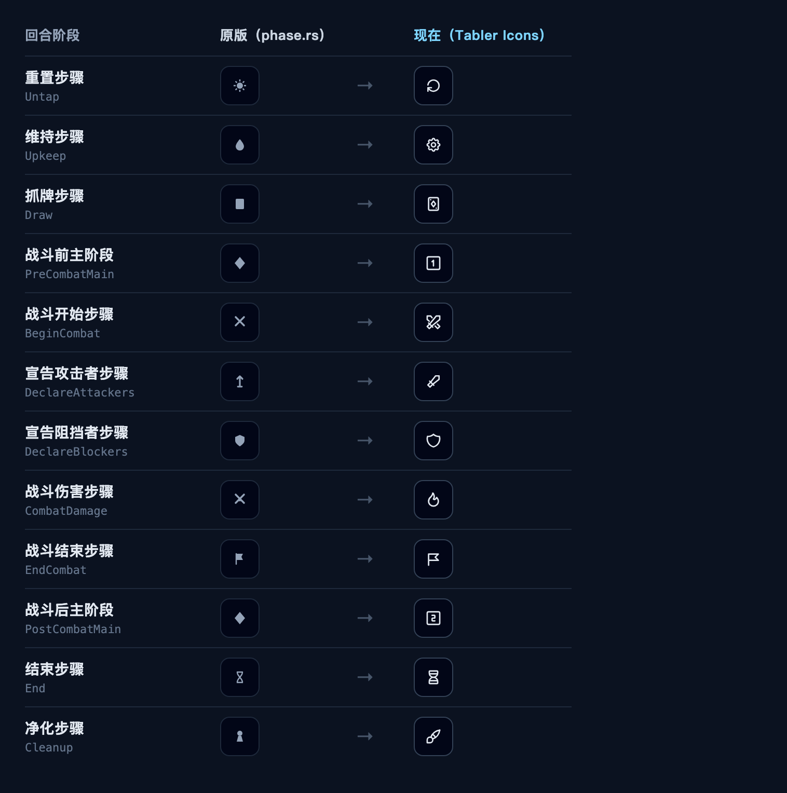

# phase-plugin

给 [phase.rs](https://phase-rs.dev) 网页版做的两件事，都在**一个书签**里，不用装任何东西：

1. **卡图换成简体中文** —— 走[大学院废墟](https://mtgch.com)（mtgch.com）的图床
2. **回合阶段图标换成更好认的图形** —— 12 个图标，全部来自 [Tabler Icons](https://tabler.io/icons)

## 图标：原版 vs 现在

原版有两个**一眼分不出**的地方，这是换图标的主要动机：

- **两个主阶段用的是同一个菱形** —— 原版 `PreCombatMain` 与 `PostCombatMain` 在源码里是
  两段一模一样的 JSX。现在是方框 `1` 和方框 `2`。
- **战斗开始与战斗伤害都是交叉双剑** —— 只差中心一个圆点。现在是交叉双剑与火焰。

完整清单（每个都带 10px / 14px / 激活三态的渲染）：
**[preview/current-icons.html](preview/current-icons.html)**

## 安装（30 秒）

### 👉 [点这里打开安装页](https://haowen1993.github.io/phase-plugin/)

1. 打开上面那个页面
2. 把页面里的红色「**中文卡图**」按钮**拖到书签栏**
   （拖不动就右键它 → 添加到书签。没有书签栏按 <kbd>⌥⌘B</kbd> 或 <kbd>Ctrl+Shift+B</kbd>）
3. 打开 <https://phase-rs.dev>，**点一下书签栏里的「中文卡图」**

> ⚠️ **每次刷新或重新打开页面后，都要再点一下书签。**（页面内跳转不用点）
> 这就是「零安装」的代价。

点一下两件事一起生效，不需要分别点。

## 它做什么

### 一、卡图换成大学院废墟的图

| 这张卡的情况 | 你会看到 |
| --- | --- |
| 大学院废墟有简体中文图 | **中文卡图** |
| 没有中文图 | 大学院废墟的英文图 |
| 查不到 | 原来的 Scryfall 图（兜底） |

正面、背面（双面牌）、大小尺寸、衍生物都覆盖。全程自动，你不需要做任何判断。

**中英文界面都生效。** 中文界面下 phase.rs 会把卡图地址本地化成「中文印刷 id」，而
大学院图床只认「英文印刷 id」——我们会拿到 phase.rs 自己那张本地化表（能截获响应就截获，
截不到就自己取一次，有 ETag 基本不花流量），按 URL 精确匹配还原出英文 id，再问大学院。
细节见 [NOTES.md](NOTES.md) 的「卡图」一节。

**关于速度**：换图前会先把大学院的图拉进缓存（「先暖后换」），所以换的那一刻不会出现
空白/闪烁 —— 应用原来那张图会一直显示到新图就绪。已经暖过的地址下次打开页面仍然算暖
（大学院图床是一年不可变的强缓存），实测第二次起换图约 **9ms**。

### 二、阶段图标换成更好认的图形

| 阶段 | 新图形 |  | 阶段 | 新图形 |
| --- | --- | --- | --- | --- |
| 重置 | 顺时针环形箭头 | | 宣告阻挡者 | 盾牌 |
| 维持 | 齿轮 | | 战斗伤害 | 火焰 |
| 抓牌 | 卡牌 | | 战斗结束 | 三角旗 |
| 战斗前主阶段 | 方框 `1` | | 战斗后主阶段 | 方框 `2` |
| 战斗开始 | 交叉双剑 | | 结束步骤 | 沙漏 |
| 宣告攻击者 | 单手剑 | | 净化 | 刷子 |

图标**只来自一家**（Tabler，MIT 许可）——这样只需要遵守一份许可。版权声明与许可全文见
[THIRD-PARTY-NOTICES.md](THIRD-PARTY-NOTICES.md)。

尺寸、颜色行为都和原版一致：图标跟随所处状态变色（未激活灰、悬停变白、激活纯白），
手机端 10px、桌面端 14px，全部保留响应式。

## 常见问题

**点了没反应？** 多半是忘了点书签，或刷新之后没再点。

**有些卡还是英文？** 正常——大学院废墟没有那些印刷的中文图，自动用了它的英文图。

**阶段图标没换，或者只换了一部分？** 先确认点过书签，控制台应打印
`[phase-plugin] 已启用 v…`。脚本对**认不出来的容器故意不动**（宁可保留原版，也不要把图标
画到错误的阶段上）。若确实有个别图标没换，告诉我它出现在哪里。

**图标看不太清？** 桌面端 14px 下最清楚；手机端未激活时只有 10px，本来就小。

**想换浏览器或换电脑？** 新建一个书签，把地址换成 `dist/phase-plugin.bookmarklet.txt`
里的那一行即可，任何浏览器、任何系统都行。

**想发给别人？** 把上面那个安装页网址发过去就行。

**卡图变成文字占位卡？** 不正常，请告诉我卡名。

## 想深入了解

卡图的三级降级阶梯为什么这么设计、为什么不能交给应用自己的 `onError`、怎么避免 404
死循环、阶段图标怎么认出每个 SVG 是哪个阶段、怎么重新构建、phase.rs 更新后要不要改、
怎么分发——

都写在 **[NOTES.md](NOTES.md)** 里（那是一份长文档，按需查阅）。

## 许可

代码用 [MIT](LICENSE)——随便用、改、再发，保留版权声明即可。

阶段图标来自 [Tabler Icons](https://tabler.io/icons)（MIT），可一并再分发。
第三方资产的版权声明与许可全文见 [THIRD-PARTY-NOTICES.md](THIRD-PARTY-NOTICES.md)。

**卡图不在本仓库的许可范围内**：它们由大学院废墟（[mtgch.com](https://mtgch.com)）提供，
本工具只在显示时把浏览器指向那个图床，不复制、不缓存、不再分发。
