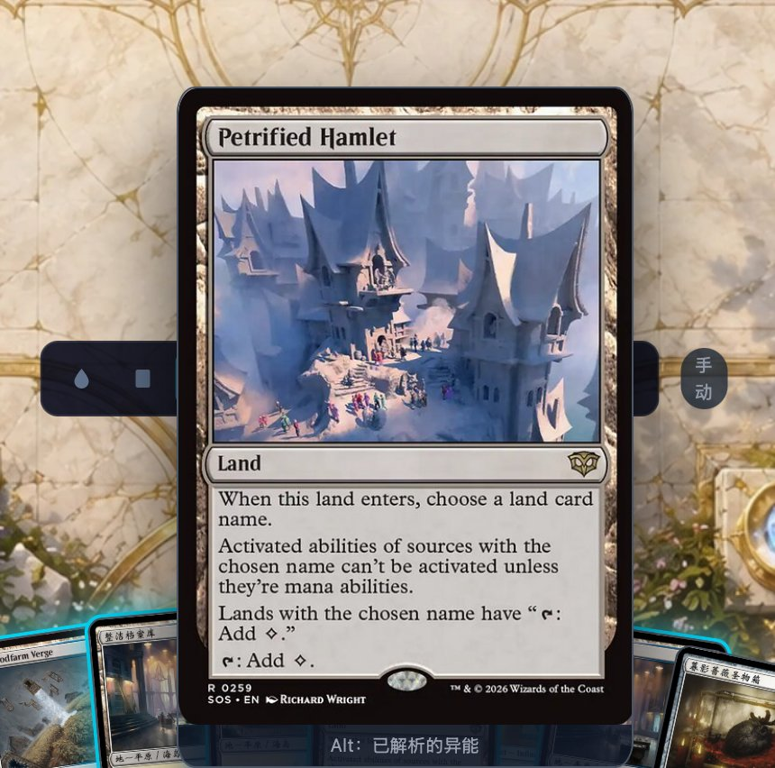
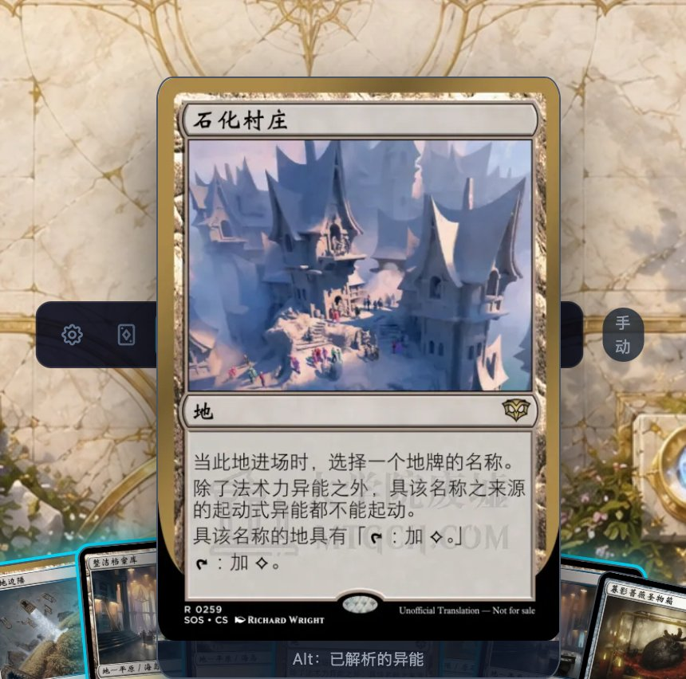
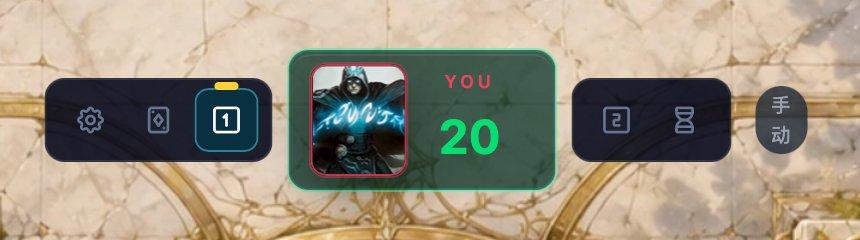

# phase-plugin

给 [phase.rs](https://phase-rs.dev) 网页版换两样东西：**简体中文卡图**、**一眼能分辨的阶段图标**。书签小工具，零安装。

**👉 [打开安装页](https://haowen1993.github.io/phase-plugin/)** —— 把按钮拖到书签栏，在 phase-rs.dev 点一下（刷新或重开页面后要再点一次）。

## 卡图

| 原来 | 现在 |
|:---:|:---:|
|  |  |

## 阶段图标

| 原来 | 现在 |
|:---:|:---:|
|  |  |

两个主阶段原来是同一个菱形；战斗开始与战斗伤害原来是同一个叉。

| 原来 | 现在 |
|:---:|:---:|
|  |  |

12 个阶段的完整对照：**[docs/icon-comparison.png](docs/icon-comparison.png)**；交互版（含 10px 与激活态）：**[preview/current-icons.html](preview/current-icons.html)**。

## 说明

- 卡图中文优先；没有中文图就用大学院废墟的英文图，查不到才回落 Scryfall。正反面、大小图、衍生物都覆盖。
- 换图前先把新图拉进缓存，**不会闪**。
- 图标认不出来的容器**故意不动**——宁可保留原版，也不把图标画到错误的阶段上。

## 许可

代码 [MIT](LICENSE)；阶段图标来自 [Tabler Icons](https://tabler.io/icons)（MIT），第三方声明见 [THIRD-PARTY-NOTICES.md](THIRD-PARTY-NOTICES.md)。
**卡图不在本仓库许可范围内**：图由大学院废墟提供，本工具只在显示时把浏览器指向那个图床，不复制、不缓存、不再分发。

实现细节、踩过的坑、怎么重新构建：**[NOTES.md](NOTES.md)**。
